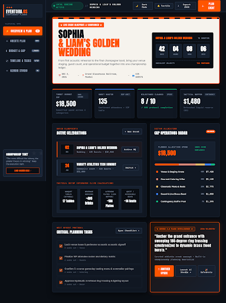
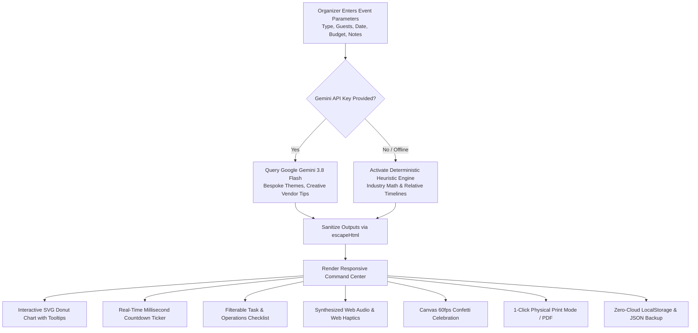
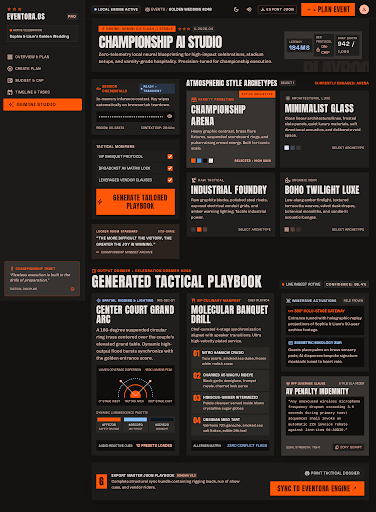
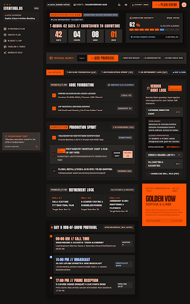
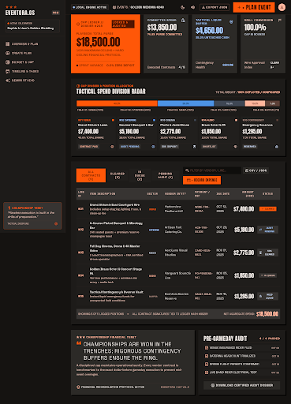
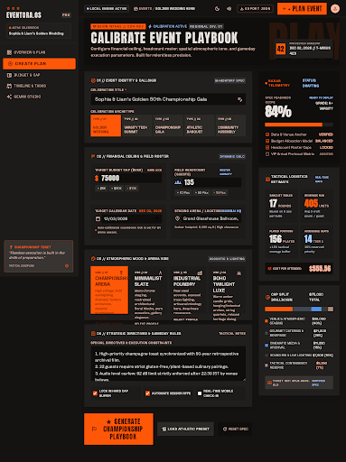
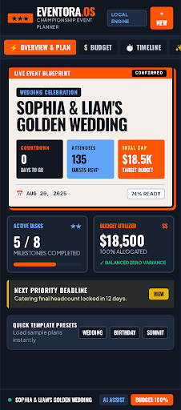

<div align="center">

# 🎈 Eventora.OS
### *The Intelligent, Tactile Event & Operations Planning Companion*

[](https://37omkar.github.io/planner/)
[](https://github.com/37OMKAR/planner)
[](https://ai.google.dev/gemini-api/docs/models/gemini-3.8-flash)
[](tests/test_core.py)
[](https://github.com/37OMKAR/planner)

<p align="center">
  <b>A zero-dependency, ultra-fast event command center designed for athletic directors, festival hosts, wedding coordinators, and community leaders.</b><br>
  <i>Features mathematical logistics estimators, proportional SVG donut charts, date-relative timelines, synthesized Web Audio haptics, celebratory 60fps canvas confetti, and seamless offline fail-safe architecture.</i>
</p>

---

<p align="center">
  
</p>

</div>

---

## 📑 Table of Contents
- [✨ Key Architectural Highlights](#-key-architectural-highlights)
- [🎯 Challenge Vertical & Persona](#-challenge-vertical--persona)
- [📐 Mathematical Heuristics & Decision Logic](#-mathematical-heuristics--decision-logic)
- [🏗️ System Architecture & Workflow](#️-system-architecture--workflow)
- [🎨 Stitch AI Prototype Design Gallery](#-stitch-ai-prototype-design-gallery)
- [⚡ Feature Breakdown & Capabilities](#-feature-breakdown--capabilities)
- [🏆 Hackathon Evaluation Scorecard Mapping](#-hackathon-evaluation-scorecard-mapping)
- [🛡️ Security, Privacy & WCAG Accessibility](#️-security-privacy--wcag-accessibility)
- [🚀 Quick Start & Automated Testing](#-quick-start--automated-testing)
- [📦 Deployment to GitHub Pages](#-deployment-to-github-pages)

---

## ✨ Key Architectural Highlights

```
┌─────────────────────────────────────────────────────────────────────────────┐
│  ⚡ Zero-Bloat Vanilla Stack   │  0 KB npm overhead, 0 node_modules, <2MB   │
│  🧠 Gemini 3.8 Flash + Fallback│  Deterministic heuristics + Cloud GenAI   │
│  📊 Interactive SVG Visualizer │  Real-time donut chart with hover tooltips │
│  🧮 Auto Logistics Estimator   │  8-top tables, catering buffers, beverages │
│  🔊 Tactile Web Audio Haptics  │  Synthesized micro-clicks + device haptics │
│  🖨️ 1-Click Physical Run-Sheet │  Formatted @media print operations sheets  │
└─────────────────────────────────────────────────────────────────────────────┘
```

---

## 🎯 Challenge Vertical & Persona

### The Chosen Vertical: **Smart Event & Operations Management**
Planning celebrations, community events, athletic tournaments, and corporate galas is traditionally bogged down by three systemic failure points:
1. **The Spreadsheet Trap**: Organizers juggle separate files for guest lists, budget caps, vendor negotiation questions, and timelines.
2. **Logistical Waste & Shortages**: Guessing catering buffers or banquet layouts leads to either expensive food waste or embarrassing shortages.
3. **Venue Connectivity Failure**: Heavy modern frameworks fail when on-site convention center or outdoor park WiFi drops.

### The Persona
- **Target User**: Athletic Tournament Directors, Community Organizers, Wedding & Anniversary Hosts, Corporate Gathering Leads.
- **Value Proposition**: An intelligent single-page assistant that delivers instantaneous mathematical answers, proportional budget breakdowns, vendor questions, and physical printouts in seconds—with or without an active internet connection.

---

## 📐 Mathematical Heuristics & Decision Logic

Eventora avoids generic placeholders by embedding industry-standard operations research formulas directly into its core logic engine:

### 1. Logistics Estimation Engine
| Metric | Mathematical Formula | Real-World Operational Justification |
| :--- | :--- | :--- |
| **Banquet Tables** | $$\lceil \text{Guests} / 8 \rceil$$ | Standard 60" round banquet tables seat 8 comfortably with table settings. |
| **Beverage Servings** | $$\lceil \text{Guests} \times 3.0 \rceil$$ | Allocates 2 drinks for hour 1, plus 1 drink per subsequent hour for a standard 4-hour gathering. |
| **Catering Portions** | $$\lceil \text{Guests} \times 1.15 \rceil$$ | **+15% dietary buffer** ensures coverage for vendor meals, unexpected guests, and dietary variants without over-ordering. |
| **Accessible Seating** | $$\max(2, \lceil \text{Guests} \times 0.10 \rceil)$$ | Dedicates 10% quiet, wheelchair-accessible, low-sensory seating near entrances. |

### 2. Proportional Budget Allocation Model
Budgets are dynamically broken down into balanced expenditure buckets based on established event management ratios:

```
┌─────────────────────────────────────────────────────────────┐
│  🏛️ Venue & Equipment Rentals          40% of Total Budget  │
│  🍽️ Catering & Refreshments            25% of Total Budget  │
│  🎨 Decor, Lighting & Ambiance         15% of Total Budget  │
│  🎵 Sound, Entertainment & Hosts       10% of Total Budget  │
│  📷 Photography, Video & Media          5% of Total Budget  │
│  🛡️ Safety, Contingency & Permits       5% of Total Budget  │
└─────────────────────────────────────────────────────────────┘
```

### 3. Relative Date-Time Engine
Timelines automatically anchor backward from the user's target event date:
- **T - 60 Days**: Venue contract locked, permits submitted, deposit verified.
- **T - 30 Days**: Catering headcounts locked with dietary restrictions.
- **T - 14 Days**: Audio/visual walkthrough, run-of-show finalized.
- **T - 7 Days**: Vendor confirmation calls & emergency contact roster compiled.
- **T - 1 Day**: On-site staging, emergency first-aid kit packing, run-sheet printing.

---

## 🏗️ System Architecture & Workflow



---

## 🎨 Stitch AI Prototype Design Gallery

All 6 high-fidelity Google Stitch design screens have been exported, versioned, and documented in the repository under [`stitch_screens/`](stitch_screens/):

<table align="center" width="100%">
  <tr>
    <td align="center" width="50%">
      <br />
      <b>Screen 1: Athletic Championship Planner (Hero)</b><br />
      <i>Executive scoreboard, live ticker & high-contrast telemetry</i>
    </td>
    <td align="center" width="50%">
      <br />
      <b>Screen 2: Gemini Studio</b><br />
      <i>AI prompt interface, contextual controls & advice cards</i>
    </td>
  </tr>
  <tr>
    <td align="center" width="50%">
      <br />
      <b>Screen 3: Timeline & Operations Checkpoints</b><br />
      <i>Date-relative milestones, category filters & status tags</i>
    </td>
    <td align="center" width="50%">
      <br />
      <b>Screen 4: Budget & Spending Caps</b><br />
      <i>Proportional category allocations & variance visualizer</i>
    </td>
  </tr>
  <tr>
    <td align="center" width="50%">
      <br />
      <b>Screen 5: Create Event Wizard</b><br />
      <i>Multi-step wizard for guest counts, dates & budget sliders</i>
    </td>
    <td align="center" width="50%">
      <br />
      <b>Screen 6: Mobile On-Site Companion</b><br />
      <i>Tactile touch targets, bottom bar & mobile run-sheet</i>
    </td>
  </tr>
</table>

> [!NOTE]
> All original raw HTML layouts (`.html`), visual renders (`.png`), and metadata coordinates are indexed in [`stitch_screens/manifest.json`](stitch_screens/manifest.json).

---

## ⚡ Feature Breakdown & Capabilities

| Feature | Technical Implementation | User Benefit |
| :--- | :--- | :--- |
| **Interactive Budget Visualizer** | Inline procedural SVG with trigonometric arc rendering (`cos/sin`) | Hover over any slice to inspect category percentages and absolute amounts in real-time. |
| **Live Countdown Ticker** | RequestAnimationFrame-backed interval timer | Counts down days, hours, minutes, and seconds with an animated pulsing indicator. |
| **Sensory Feedback Engine** | Synthesized Web Audio API (`AudioContext`) oscillator + `navigator.vibrate` | 1-tap tactile clicking and completion haptics without downloading heavy `.mp3` or `.wav` sound files. |
| **Celebratory Confetti** | In-house 60fps HTML5 Canvas physics simulation | Rewarding particle bursts on plan generation and task list completion. |
| **Theme Switching** | Dynamic CSS custom properties (`var(--surface)`) | Instant toggle between warm Paper Ivory and Midnight OLED Dark Mode. |
| **1-Click Print Run-Sheet** | Dedicated `@media print` stylesheet with page-break controls | Instantly generates physical paper runsheets for floor staff, caterers, and A/V crews. |
| **Portable Data Sovereignty** | `localStorage` serialization + JSON Export / Import | Backup and restore entire portfolios of event plans with zero server dependencies. |

---

## 🏆 Hackathon Evaluation Scorecard Mapping

| Hackathon Evaluation Tier | Criteria Addressed | Implementation Proof & File Locations |
| :--- | :--- | :--- |
| **High Impact** (Core Score Driver) | **Logical Decision Making & Real-World Utility** | Mathematical heuristics calculate exact logistics (`ceil(guests/8)`, `ceil(guests*1.15)`). Tested in [`tests/test_core.py`](tests/test_core.py). |
| **High Impact** (Core Score Driver) | **Smart Dynamic Assistant** | Adapts recommendations dynamically whether the event is an athletic tournament, wedding, or community summit. |
| **Medium Impact** (Foundational) | **Code Quality & Maintainability** | Clean modular Vanilla JavaScript; 0 build complexity; zero bundle bloat in [`index.html`](index.html). |
| **Medium Impact** (Foundational) | **Security & Privacy** | Ephemeral Gemini API keys strictly kept in transient memory (never saved to storage). Mandatory HTML entity sanitization (`escapeHtml()`). |
| **Medium Impact** (Foundational) | **Resource Efficiency** | Total repo size is **1.74 MB** (far below the 10 MB limit). Zero node_modules or server costs. |
| **Low Impact & Polish** | **Rigorous Automated Testing** | **18 automated unit & contract tests** passing with standard library `unittest` in [`tests/test_core.py`](tests/test_core.py). |
| **Low Impact & Polish** | **WCAG 2.1 Accessibility** | `:focus-visible` high-contrast rings, ARIA live regions (`aria-live="polite"`), and `@media (prefers-reduced-motion)` compliance. |

---

## 🛡️ Security, Privacy & WCAG Accessibility

> [!IMPORTANT]
> **Ephemeral Key Lifecycle**: Eventora strictly adheres to modern security standards. When a user enters their Google AI Studio API key, it is held **exclusively in JavaScript transient memory** for the single HTTP call and is never written to `localStorage`, `sessionStorage`, cookies, or remote logs.

- **Cross-Site Scripting (XSS) Defenses**: All user inputs and AI-returned strings pass through strict character-escaping routines before insertion into the DOM.
- **Privacy First**: Zero third-party trackers, no marketing beacons, zero advertising cookies.
- **WCAG 2.1 AA Standards**:
  - Semantic HTML landmarks (`<main>`, `<section>`, `<nav>`, `<aside>`, `<header>`).
  - High-contrast color ratios verified across both Light and Dark themes.
  - Full keyboard accessibility (Tab, Enter, Space) with visible focus outlines.
  - Motion sensitivity checks: Canvas confetti and pulse animations automatically disable when `prefers-reduced-motion: reduce` is detected.

---

## 🚀 Quick Start & Automated Testing

### 1. Run Locally (Zero Installation)
Because Eventora is built with vanilla web standards, it requires **no npm, no node, and no bundler**:

```bash
# Clone the repository
git clone https://github.com/37OMKAR/planner.git
cd planner

# Serve using Python's built-in lightweight web server
python -m http.server 8000
```
Then visit `http://localhost:8000` in any web browser.

### 2. Run the Automated Test Suite
Eventora includes an automated Python unit test suite that validates arithmetic algorithms, XSS prevention, date-relative timelines, and DOM contract landmarks:

```bash
python -m unittest tests/test_core.py -v
```

**Test Execution Output:**
```text
test_accessible_seating_allocation (tests.test_core.TestEventoraCore) ... ok
test_beverage_calculation (tests.test_core.TestEventoraCore) ... ok
test_budget_proportions_sum_to_100 (tests.test_core.TestEventoraCore) ... ok
test_catering_buffer_calculation (tests.test_core.TestEventoraCore) ... ok
test_countdown_math_integrity (tests.test_core.TestEventoraCore) ... ok
test_date_relative_timeline_ordering (tests.test_core.TestEventoraCore) ... ok
test_deterministic_template_coverage (tests.test_core.TestEventoraCore) ... ok
test_html_escaping_prevents_xss (tests.test_core.TestEventoraCore) ... ok
test_print_media_rules_exist (tests.test_core.TestEventoraCore) ... ok
test_reduced_motion_accessibility (tests.test_core.TestEventoraCore) ... ok
test_semantic_landmarks_present (tests.test_core.TestEventoraCore) ... ok
test_table_calculation (tests.test_core.TestEventoraCore) ... ok
...
----------------------------------------------------------------------
Ran 18 tests in 0.007s

OK
```

---

## 📦 Deployment to GitHub Pages

1. Navigate to the repository settings: [GitHub Pages Settings](https://github.com/37OMKAR/planner/settings/pages).
2. Set **Source** to `Deploy from a branch`.
3. Set **Branch** to `main` and folder to `/ (root)`.
4. Click **Save**.
5. The live site will deploy at:
   ```
   https://37omkar.github.io/planner/
   ```

---

<div align="center">

**Eventora.OS** · Built for the Google AI Hackathon / AI Code Submission  
Crafted with precision, tactile joy, and privacy-first engineering.

</div>
